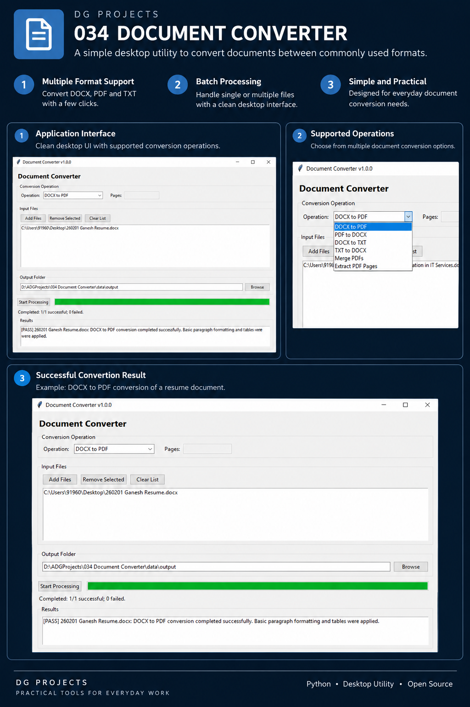
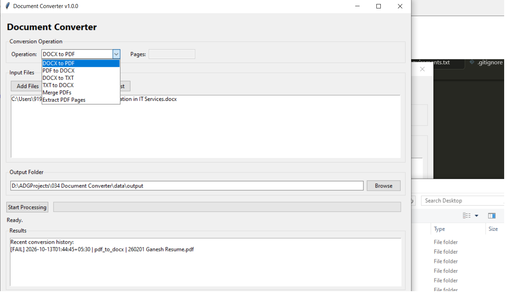
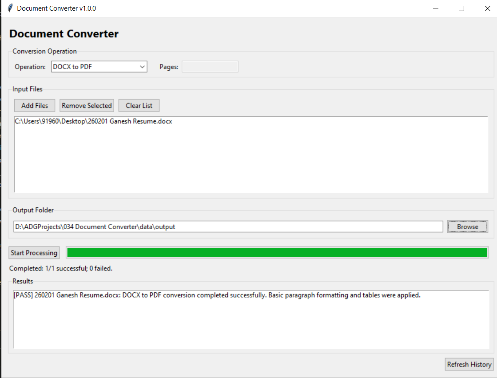

---

## 1. Project Poster

The poster image is expected at `screenshots/poster.png`.

---

## 2. Project Badges


---

## 3. Screenshots

### Main Window and Operation Selector



### Successful Conversion



---

## 4. Project Title

# DG Projects — 034 Document Converter

---

## 5. Project Overview

Document Converter is a Python desktop application that consolidates common document operations into one interface. It is intended to reduce the need to switch between separate utilities for routine document conversion and PDF tasks.

Typical use cases include converting Word documents to PDF, extracting text from PDFs into Word, converting between Word and plain text, merging PDFs, and extracting selected PDF pages. PDF output is generated programmatically, so complex Word layouts may not be reproduced exactly.

---

## 6. Features

- Convert DOCX to PDF, including paragraphs and tables with basic formatting.
- Convert PDF to DOCX using extracted text; exact page-layout reconstruction is not guaranteed.
- Convert DOCX to TXT.
- Convert TXT to DOCX.
- Merge multiple PDF files.
- Extract selected pages from a PDF.
- Batch-process eligible files.
- Choose the output folder through the desktop interface.
- Store conversion history in a local SQLite database.
- Display processing progress and conversion results.
- Preserve existing output files rather than automatically overwriting them.

---

## 7. Technology Stack

| Technology | Purpose |
| --- | --- |
| Python 3.14 | Application language and development runtime |
| Tkinter / ttk | Desktop user interface |
| `python-docx` | Read and create Word documents |
| ReportLab | Generate PDF output |
| `pypdf` | Read, merge, and extract PDF pages |
| SQLite | Persist local conversion history |
| Python standard library | File handling, paths, temporary files, threading, queues, and application support |
| Git / GitHub | Source control and repository hosting, where configured |

---

## 8. Project Structure

```text
034 Document Converter/
├── .github/
├── .gitignore
├── .vscode/
├── LICENSE
├── main.py
├── pyproject.toml
├── README.md
├── requirements.txt
├── assets/
│   ├── fonts/
│   ├── icons/
│   ├── images/
│   └── templates/
├── data/
│   ├── conversion_history.sqlite3
│   ├── input/
│   ├── output/
│   └── samples/
├── docs/
│   └── UserGuide.md
├── logs/
│   └── execution_report.txt
├── releases/
│   ├── latest/
│   ├── v1.0/
│   └── v1.1/
├── screenshots/
│   ├── Action-selector-and-file-picker.png
│   ├── poster.png
│   └── process-successful-message.png
├── src/
│   ├── config.py
│   ├── core/
│   ├── models/
│   ├── services/
│   │   ├── batch_conversion_service.py
│   │   ├── conversion_history_service.py
│   │   ├── document_conversion_service.py
│   │   ├── environment_service.py
│   │   ├── execution_report_service.py
│   │   ├── pdf_operation_service.py
│   │   ├── pdf_to_docx_service.py
│   │   └── text_conversion_service.py
│   ├── ui/
│   │   └── main_window.py
│   └── utils/
└── tests/
```

The supplied repository snapshot does not list Python files inside `core`, `models`, `utils`, or `tests`.

---

## 9. Module Overview

| **Module** | **Responsibility** |
| --- | --- |
| `main.py` | Application entry point; runs startup checks, launches the desktop application, and records execution status. |
| `src/config.py` | Central application settings, supported formats, project paths, and output behavior. |
| `src/ui/` | Tkinter interface, file selection, operation selection, progress, results, and history display. |
| `src/services/` | Conversion services, batch coordination, PDF operations, conversion history, environment validation, and execution reporting. |
| `assets/` | Locations for application fonts, icons, images, and templates. |
| `data/` | Local input, output, sample, and conversion-history data. |
| `docs/` | User documentation. |
| `logs/` | Runtime execution report. |
| `releases/` | Folders for release-related artifacts. |
| `tests/` | Test directory; no test files were shown in the supplied tree. |

---

## 10. Source Code Overview

| **Source File** | **Purpose** | **Dependencies** |
| --- | --- | --- |
| `main.py` | Starts the application, performs environment checks, initializes the desktop window, and records startup/shutdown status. | `src.config`, `src.services.environment_service`, `src.services.execution_report_service`, `src.ui.main_window` |
| `src/config.py` | Defines application constants, supported formats, project directories, and output behavior. | Python standard library |
| `src/services/batch_conversion_service.py` | Coordinates sequential batch conversion for DOCX, PDF, and text operations and returns per-file results. | Internal conversion services |
| `src/services/conversion_history_service.py` | Stores and retrieves conversion attempts, statuses, messages, and error details in SQLite. | Python standard library; `src.config` |
| `src/services/document_conversion_service.py` | Converts DOCX paragraphs and tables to PDF and validates the generated file. | `python-docx`, ReportLab, `src.config` |
| `src/services/environment_service.py` | Checks the Python runtime, project structure, and required directories. | Python standard library; `src.config` |
| `src/services/execution_report_service.py` | Records execution checkpoints and produces the application execution report. | Python standard library; `src.config` |
| `src/services/pdf_operation_service.py` | Merges PDFs and extracts selected pages into a new PDF. | `pypdf`, `src.config` |
| `src/services/pdf_to_docx_service.py` | Extracts PDF text and writes it into a DOCX document; exact page-layout reconstruction is not promised. | `pypdf`, `python-docx`, `src.config` |
| `src/services/text_conversion_service.py` | Converts DOCX files to plain text and plain-text files to DOCX. | `python-docx`, `src.config` |
| `src/ui/main_window.py` | Implements the desktop interface, background processing, progress updates, results, and history display. | Tkinter; internal conversion and history services |

---

## 11. How to Run

### Prerequisites

- Windows and an installed Python runtime.
- Packages listed in `requirements.txt`.

Install dependencies from PowerShell in the project root:

```powershell
python -m pip install -r requirements.txt
```

Launch the application:

```powershell
python main.py
```

Select an operation, add input files, choose an output folder, and click **Start Processing**. For **Extract PDF Pages**, enter page numbers or ranges such as `1,3,5-7`. For **Merge PDFs**, select at least two PDF files.

The default output directory is `data/output`.

---

## 12. How to Build

The supplied project snapshot does not confirm a PyInstaller configuration or dependency. The supported run method documented here is to launch the source with `python main.py`.

A standalone executable should only be documented after a packaging configuration has been added and tested. Therefore, no PyInstaller command or executable output location is specified at this stage.

---

## 13. Version

| Field | Value |
| --- | --- |
| Current Version | 1.0.0 |
| Release Date | 13 October 2026 |
| Status | DOCX-to-PDF conversion verified; validate remaining operations individually before release. |

---

## 14. Development Workflow

```text
Requirements and Scope
        ↓
Design and Module Planning
        ↓
Implementation
        ↓
Environment and Functional Testing
        ↓
Output and Error-Handling Verification
        ↓
Documentation and Screenshots
        ↓
Packaging Configuration and Build Validation
        ↓
Versioned Release
```

---

## 15. License

A `LICENSE` file is present in the repository root. Refer to that file for the applicable license terms.
